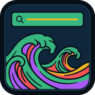

<p align="center">
  
</p>

# Tide

[](https://github.com/UberMetroid/tide/actions/workflows/ci.yml)
[](https://github.com/UberMetroid/tide/releases/latest)
[](LICENSE)
[](https://ubermetroid.github.io/tuition-not-coffee)
[](https://github.com/UberMetroid/tide)

**Tide** (`tide@ubermetroid.github.io`) is a fast, zero-subprocess, Wayland-native **Super-Key Application & Open-Window Launcher** for **GNOME Shell 45–50**. Press **Super** to summon a sleek modal search bar with instant fuzzy application and open-window matching across workspaces, **Ctrl+1..Ctrl+9** direct launch shortcuts, Kelp/Reef/Coral accent borders, and a **3-tab Libadwaita Settings & About dialog**.

Derived from [Pop Launcher Super-Key Standalone](https://github.com/icesx/gnome-shell-extension-pop-launcher-super-key) (`pop-launcher-super-key@icesx` by icesx, itself forked from [ManeLippert/gnome-shell-extension-pop-launcher-super-key](https://github.com/ManeLippert/gnome-shell-extension-pop-launcher-super-key) and inspired by System76 Pop Shell) — upgraded with cross-workspace **Open-Window Search & Switching**, fuzzy subsequence scoring, `Ctrl+1..9` shortcut badges, customizable Ocean Cyan / Kelp / Reef / Coral accent borders, and engineered under the same strict [`AGENTS.md`](AGENTS.md) Page Rule and EGO standards as [**Kelp**](https://github.com/UberMetroid/kelp), [**Reef**](https://github.com/UberMetroid/reef), [**Shoal**](https://github.com/UberMetroid/shoal), [**Coral**](https://github.com/UberMetroid/coral), and [**Seabed**](https://github.com/UberMetroid/seabed). Official project artwork is archived in [`brand/`](brand/) (`icon-512.png`, `icon-256.png`, `icon-160.png`, `favicon-64.png`).

> 🎓 **Support Tide — [Tuition, Not Coffee — Help send my daughter to college](https://ubermetroid.github.io/tuition-not-coffee)** · 🌐 [**Project Website (`ubermetroid.github.io/tide`)**](https://ubermetroid.github.io/tide/) · ⭐ [**Star UberMetroid/tide on GitHub**](https://github.com/UberMetroid/tide)

---

## Designed to Pair with Kelp, Reef, Shoal, Coral & Seabed (and Standalone GNOME)

| Feature | Default | Why It Matters |
| :--- | :--- | :--- |
| **Instant Super-Key Modal Launcher** | **Active (`launcher`)** | Press **Super** to open or close Tide immediately without opening the full GNOME Overview or requiring Pop Shell / external `pop-launcher` daemons. |
| **Open-Window & App Fuzzy Search** | **Active** | Searches both installed applications (`Shell.AppSystem` + `Shell.AppUsage` frequency) and open windows across all workspaces so you can jump straight to a running window or launch a new app. |
| **`Ctrl+1` .. `Ctrl+9` Quick Launch** | **Built-in** | Launch or focus any of the first nine results immediately with `Ctrl+1` through `Ctrl+9`, or navigate with `Up` / `Down` and `Enter`. |
| **Stationary-Pointer Hover Guard** | **Built-in** | Keeps initial keyboard selection locked on the top result when the modal opens beneath a stationary mouse cursor until you intentionally move the pointer. |
| **Ocean Cyan / Kelp / Reef Accent Border** | **Ocean Cyan (`2px`, `18px` radius)** | Features a customizable high-contrast accent border and selected-row highlight with 1-click presets (*Ocean Cyan*, *Kelp Emerald*, *Gruvbox Amber*, *Coral Red*). |

---

## Quick Install

Download `tide@ubermetroid.github.io.shell-extension.zip` from [**GitHub Releases (`v1.0.1`)**](https://github.com/UberMetroid/tide/releases/latest):

```bash
gnome-extensions install --force tide@ubermetroid.github.io.shell-extension.zip
gnome-extensions enable tide@ubermetroid.github.io
```

Open the 3-tab Libadwaita Preferences window anytime by clicking the gear icon inside the Tide launcher bar, or by running:

```bash
gnome-extensions prefs tide@ubermetroid.github.io
```

---

## 3-Tab Libadwaita Settings & About Window

| Tab | Controls Included |
| :--- | :--- |
| **1. Launcher & Search** | **Super Key Action** (`Tide Application & Window Launcher`, `GNOME Activities Overview`, `GNOME Overview Application Grid`), **Clear Search Query When Opening** toggle, **Close Launcher on Outside Click** toggle, **Search Open Windows Across Workspaces** toggle, **Sort Applications by Recent Usage** toggle, **Maximum Search Results** (`3–15`, default `9`), **Show Application Descriptions & Workspace Subtitles** toggle, **Show `Ctrl+1..Ctrl+9` Quick-Launch Badges** toggle, and **Reset to Tide Defaults**. |
| **2. Appearance & Styling** | **Launcher Dialog Width** (`480–960 px`, default `680 px`), **Result Application Icon Size** (`24–64 px`, default `32 px`), **Dialog Surface Opacity** (`60–100%`, default `96%`), **Show Launcher Accent Border** toggle, **Accent Border Color** picker, **Quick Color Presets** (*Ocean Cyan*, *Kelp Emerald*, *Gruvbox Amber*, *Coral Red*), **Border Width** (`0–8 px`, default `2 px`), and **Border Corner Radius** (`0–36 px`, default `18 px`). |
| **3. About & Support** | Release version (`v1.0.1`), `GPL-3.0-or-later` license & `icesx` / `ManeLippert` (`Pop Launcher Super-Key Standalone`) attribution, **Star Tide on GitHub**, **Tuition, Not Coffee — Help send my daughter to college**, **Project Website**, and **Report an Issue**. |

---

## Keyboard & Mouse Shortcuts

| Shortcut | Action |
| :--- | :--- |
| `Super` | Open the Tide launcher, or close it if already open |
| `Up` / `Down` | Move selection through results (wraps around top/bottom) |
| `Enter` | Launch the selected application or focus the selected open window |
| `Ctrl+1` ... `Ctrl+9` | Immediately activate result 1 through 9 |
| `Esc` / Outside Click | Close the Tide launcher |

---

## Multi-Distro & `systemd` Integration

Tide works out of the box across **GNOME Shell 45, 46, 47, 48, 49, and 50** on **Fedora, Debian, Ubuntu, Arch Linux, openSUSE, and NixOS**:

- **`systemd-logind` Lock & Suspend Lifecycle**: Declares `"session-modes": ["user"]` so the modal launcher cleanly closes, unblocks GNOME Shell's default `overlay-key` handler, restores `Main.wm.allowKeybinding('overlay-key', Shell.ActionMode.NORMAL | Shell.ActionMode.OVERVIEW)`, cancels any pending `[tide] style-refresh` timer, and unloads its stylesheet on screen lock or disable.
- **Accessibility & Sticky-Keys Respect**: Queries `org.gnome.desktop.a11y.keyboard` (`stickykeys-enable`) before intercepting `overlay-key` so accessibility modifier latching works uninterrupted.
- **Zero Subprocesses or Telemetry**: Never spawns external processes (`GLib.spawn_*` / `Gio.Subprocess`) or makes network calls.

---

## Verification & Development

Tide enforces strict architectural invariants (`16..=256` lines per `.js` file, `<= 200` chars per line, `<= 8` visible entries per directory, zero banned filenames, and strict process-boundary separation between `prefs.js` and compositor modules) verified by `tests/verify.js`:

```bash
xmllint --noout extension/schemas/*.xml
glib-compile-schemas --strict --dry-run extension/schemas
gjs -m tests/verify.js
gnome-extensions pack extension --force --out-dir=dist \
  --schema=schemas/org.gnome.shell.extensions.tide.gschema.xml \
  --extra-source=launcher --extra-source=ui
pipx run shexli dist/tide@ubermetroid.github.io.shell-extension.zip
```

---

## 🎓 Sponsor / Support — Tuition, Not Coffee

If Tide, Coral, Seabed, Shoal, Reef, and Kelp improve your daily Linux workflow, please consider supporting development:

- 🎓 **Sponsor / Donate**: [**Tuition, Not Coffee — Help send my daughter to college**](https://ubermetroid.github.io/tuition-not-coffee)
- 🌐 **Project Website**: [**ubermetroid.github.io/tide**](https://ubermetroid.github.io/tide/)
- ⭐ **Star on GitHub**: [**github.com/UberMetroid/tide**](https://github.com/UberMetroid/tide)

---

## License & Attribution

Released under the [GNU General Public License v3.0 or later](LICENSE) (`GPL-3.0-or-later`).

Derived from [Pop Launcher Super-Key Standalone](https://github.com/icesx/gnome-shell-extension-pop-launcher-super-key) (`pop-launcher-super-key@icesx`, `GPL-3.0-or-later`) by `icesx` and [ManeLippert/gnome-shell-extension-pop-launcher-super-key](https://github.com/ManeLippert/gnome-shell-extension-pop-launcher-super-key) (`GPL-3.0-or-later`), inspired by System76 [Pop Shell](https://github.com/pop-os/shell) and [Pop COSMIC](https://github.com/pop-os/cosmic).
